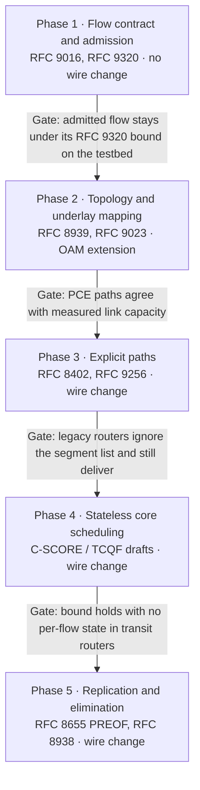

# Deterministic Networking in Zenoh

Campaign to make Zenoh carry deterministic flows by adopting existing IETF DetNet
and IEEE TSN standards rather than inventing new mechanisms. An admitted flow gets
reserved bandwidth, a bounded end-to-end latency and a loss budget.

Base: upstream `eclipse-zenoh/zenoh` `main` at `b180cc6e2` (1.10.2 + 10 commits).

## Documents

| Document | Content |
| --- | --- |
| [design.md](design.md) | Goals, principles, standards map, Zenoh baseline, architecture, risks |
| [prior-art.md](prior-art.md) | Literature check: contribution claims C1–C4, dropped claims, sources |
| [admission-model.typ](admission-model.typ) | C2 formal model: key-expression matching, admission constraints, aggregation lemmas, envelope charging, open problems |
| [routing-semantics.md](routing-semantics.md) | Zenoh `main` routing behaviour the admission model depends on, with code references |
| [architecture.typ](architecture.typ) | Architecture diagrams and use cases (preemption, multiple subscribers, stateless transit, mobility); build with `typst compile` (typst 0.15) |
| [phase-1-flow-contract-admission.md](phase-1-flow-contract-admission.md) | RFC 9016 flow contract + RFC 9320 admission on stock Zenoh |
| [phase-2-topology-underlay.md](phase-2-topology-underlay.md) | Capacity in link-state, PCE plugin, DSCP/TSN underlay mapping |
| [phase-3-explicit-paths.md](phase-3-explicit-paths.md) | Segment-list network-message extension |
| [phase-4-stateless-scheduling.md](phase-4-stateless-scheduling.md) | C-SCORE / TCQF per-message scheduling metadata |
| [phase-5-replication-elimination.md](phase-5-replication-elimination.md) | DetNet PREOF over disjoint paths |

## Roadmap

Wire changes start only after admission is proven on stock Zenoh.

| Phase | Status |
| --- | --- |
| 1 | Planning |
| 2–5 | Not started |
